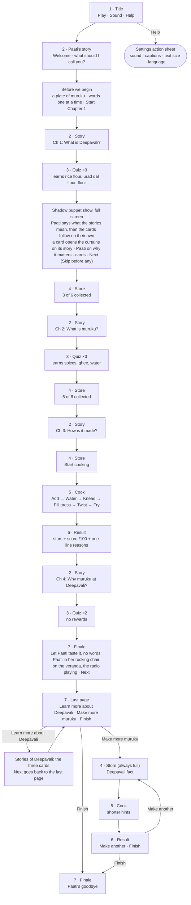

# User flow

The journey is one straight path through four chapters, followed by an optional free kitchen. Screen numbers match the [Screens table](design-brief.md#screens). Scene names match the files in [`src/scenes/`](../src/scenes).

## Rules that shape the flow

| Rule | Where it applies |
|---|---|
| A wrong answer is never a dead end: Paati explains, the choice is set aside, and the player tries again | Quiz (all chapters) |
| Stories are two short lines each, read with Next | Story |
| The puppet show fills the screen. In front of the closed curtains, Paati first says what the stories mean; once there has been time to read it, the three story cards follow on their own (a tap or Enter moves on sooner). A card opens the curtains on its story, which plays scene by scene with a subtitle for each, shown long enough to read. At its end (or Skip story) the curtains close, Paati says why that story matters, and the cards come back with it ticked. Next (Skip before any story is watched) moves on. Each card shows a picture and the story's name; a story already watched is greyed over with a Watched tag, for the rest of the visit | Puppet |
| The last page offers the stories of Deepavali again (Learn more about Deepavali, or Watch another story) and the free kitchen, with Finish under them; the stories open straight on the three cards. If no story has been watched, Paati says so, the stories are the main button, and Skip both and finish is there to skip them. Players never see the words "puppet show" | Last page |
| Paati asks what to call the player on the Welcome page (or Skip). She uses the name wherever she would say "dear"; it is kept for this visit only. Help & settings shows the name and can change it at any time, from her next line on | Welcome, then every screen; Help |
| Before we begin shows its words one at a time at reading pace, then Start Chapter 1. A tap or key press shows it all at once | Intro |
| Each correct answer in chapters 1 and 2 earns one ingredient, which flies into the Store | Quiz → Store |
| Chapter 4 answers earn nothing | Quiz (chapter 4) |
| Paati asks first and explains after. Stories are short hooks that don't give answers away | Story, Quiz |
| Paati asks one question at the start of five cooking steps; right first time unlocks her tip for that step (no penalty otherwise) | Cook (not the free kitchen) |
| Start cooking only appears once all six ingredients are collected | Store |
| Every muruku is served: no fail state, no timers | Cook → Result |
| In the free kitchen the Store is always full, and there is no quiz, shop or points | Free kitchen |
| Help opens settings from the header on every screen, and from the Title | All screens |
| A right answer sends up firecrackers (two or three stars do too) | Quiz, Result |

## Edge cases to design for

| Case | Expected behaviour |
|---|---|
| Player taps Back mid-chapter | Returns to Title. Play reads Continue and resumes at the start of the current screen (progress is kept for the session; saving between visits is open question 7) |
| Player answers wrong repeatedly | Each wrong choice is set aside (dimmed) with Paati's hint beside the answers, and the player picks again straight away, with no Try again to press. The wrong ones stay dimmed, so the right answer is always within reach |
| Player adds an ingredient in the wrong order | Paati gently names the right one; the ingredient goes back to the shelf and the order score drops |
| Player pours too much water | Paati calls "Too much!" as it passes the green zone, and the water in the meter turns amber. Water can't be taken out. The dough score drops and Paati says why on the Result screen |
| Player can't draw a smooth spiral | "Tap and hold" alternative draws a steady spiral while held |
| Player lifts without flipping | The muruku is still served; Paati notes one side is pale |
| Sound is off | Every spoken line is already on screen as text |
| Player skips the name, or leaves it empty | Paati calls them "dear", as before. They can add one later in Help & settings |
| Player changes their name in Help & settings | Paati uses the new name from her next line. A line already on screen keeps the old one; the Welcome heading and name box update when the sheet closes. An empty box brings back "dear" |
| Reduce motion is on | Sparkles, fireworks and the flying ingredient are replaced by a simple fade. Before we begin shows all its words at once. The puppet show's curtains open and close at once, Paati's page and the cards appear without fading in (and without the bar that counts down to the cards), and its scenes change without the puppets walking, the trees swaying or the lamp light flickering; its diyas are already lit. When Paati tastes the muruku, her rocking chair stays still, the radio's notes and the lamps don't move, and her pictures change in place |
