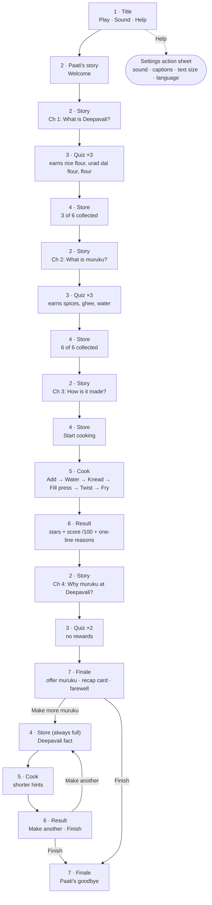

# User flow

The journey is one straight path through four chapters, followed by an optional free kitchen. Screen numbers match the [Screens table](design-brief.md#screens). Scene names match the files in [`src/scenes/`](../src/scenes).

## Rules that shape the flow

| Rule | Where it applies |
|---|---|
| A wrong answer is never a dead end: Paati explains, the choice is set aside, and the player tries again | Quiz (all chapters) |
| Each correct answer in chapters 1 and 2 earns one ingredient, which flies into the Store | Quiz → Store |
| Chapter 4 answers earn nothing | Quiz (chapter 4) |
| Start cooking only appears once all six ingredients are collected | Store |
| Every muruku is served: no fail state, no timers | Cook → Result |
| In the free kitchen the Store is always full, and there is no quiz, shop or points | Free kitchen |
| Help opens settings from the header on every screen, and from the Title | All screens |

## Edge cases to design for

| Case | Expected behaviour |
|---|---|
| Player taps Back mid-chapter | Returns to Title. Play reads Continue and resumes at the start of the current screen (progress is kept for the session; saving between visits is open question 7) |
| Player answers wrong repeatedly | Each wrong choice is dimmed after Paati's explanation, so the right answer is always reached in at most 3 taps |
| Player adds an ingredient in the wrong order | Paati gently names the right one; the ingredient goes back to the shelf and the order score drops |
| Player pours too much water | Water can't be taken out. The dough score drops and Paati says why on the Result screen |
| Player can't draw a smooth spiral | "Tap and hold" alternative draws a steady spiral while held |
| Player lifts without flipping | The muruku is still served; Paati notes one side is pale |
| Sound is off | Every spoken line is already on screen as text |
| Reduce motion is on | Sparkles, fireworks and the flying ingredient are replaced by a simple fade |
