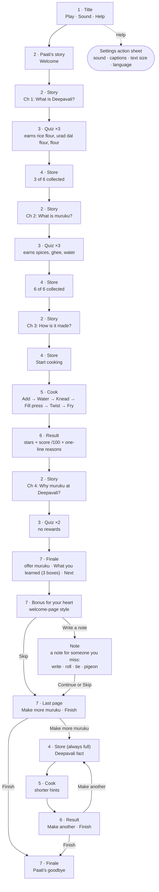

# User flow

The journey is one straight path through four chapters, followed by an optional free kitchen. Screen numbers match the [Screens table](design-brief.md#screens). Scene names match the files in [`src/scenes/`](../src/scenes).

## Rules that shape the flow

| Rule | Where it applies |
|---|---|
| A wrong answer is never a dead end: Paati explains, the choice is set aside, and the player tries again | Quiz (all chapters) |
| Stories are two or three lines; most have one thing to tap (kolam, lamps, a bite, cooling), and Next waits for it | Story |
| After the offering, the player taps three jars to share them before What you learned | Finale |
| Each correct answer in chapters 1 and 2 earns one ingredient, which flies into the Store | Quiz → Store |
| Chapter 4 answers earn nothing | Quiz (chapter 4) |
| Paati asks first and explains after. Stories are short hooks that don't give answers away | Story, Quiz |
| Paati asks one question at the start of five cooking steps; right first time unlocks her tip for that step (no penalty otherwise) | Cook (not the free kitchen) |
| Start cooking only appears once all six ingredients are collected | Store |
| Every muruku is served: no fail state, no timers | Cook → Result |
| In the free kitchen the Store is always full, and there is no quiz, shop or points | Free kitchen |
| Help opens settings from the header on every screen, and from the Title | All screens |
| A right answer sends up firecrackers (two or three stars do too) | Quiz, Result |
| The note for someone you miss comes once, after What you learned, and can be skipped. It is never saved or sent | Bonus, Note |

## Edge cases to design for

| Case | Expected behaviour |
|---|---|
| Player taps Back mid-chapter | Returns to Title. Play reads Continue and resumes at the start of the current screen (progress is kept for the session; saving between visits is open question 7) |
| Player answers wrong repeatedly | Each wrong choice is dimmed after Paati's hint, and the choices pause until Try again. The wrong ones stay dimmed, so the right answer is always within reach |
| Player adds an ingredient in the wrong order | Paati gently names the right one; the ingredient goes back to the shelf and the order score drops |
| Player pours too much water | Paati calls "Too much!" as it passes the green zone, and the water in the meter turns amber. Water can't be taken out. The dough score drops and Paati says why on the Result screen |
| Player can't draw a smooth spiral | "Tap and hold" alternative draws a steady spiral while held |
| Player lifts without flipping | The muruku is still served; Paati notes one side is pale |
| Sound is off | Every spoken line is already on screen as text |
| Reduce motion is on | Sparkles, fireworks and the flying ingredient are replaced by a simple fade. On the Note screen, the scroll rolls, is tied and leaves at once, without the pigeon's flight |
| Player tries to roll up an empty note | Paati asks for a few words first; just a name is enough |
| A phone keyboard opens over the note | The game waits until typing ends before it re-fits the screen, and the fields stay at 16 px or larger so phones don't zoom in |
